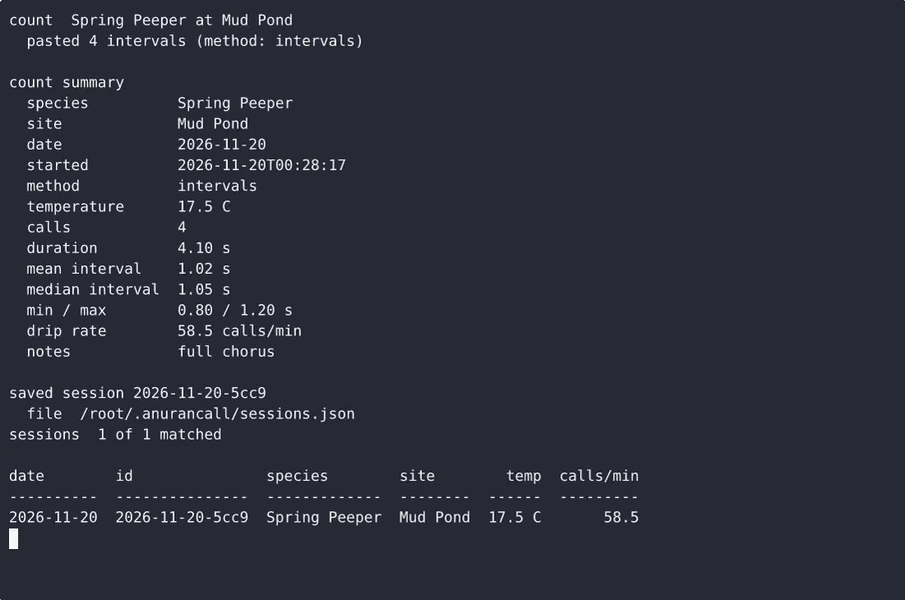
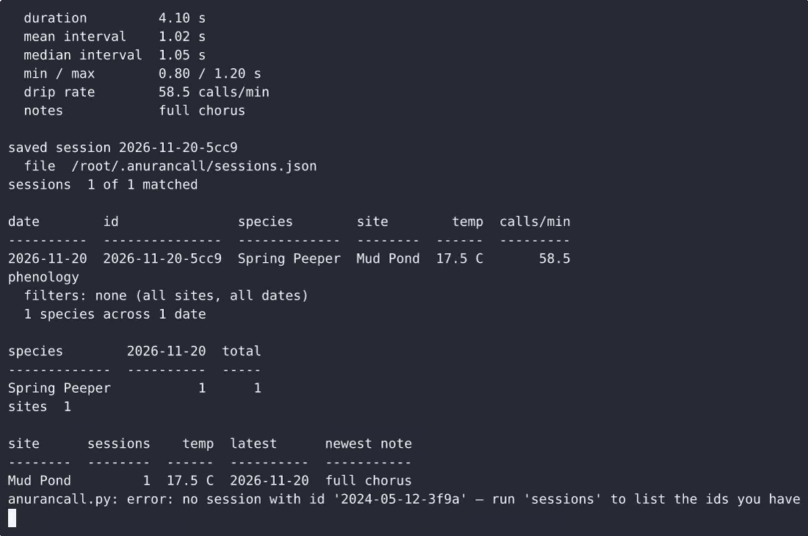

# AnuranCall — complete Full-stack app command-line tool example app

This repository contains the complete source for **AnuranCall**, an open-source command-line tool built with Full-stack app. AnuranCall is a single-file, standard-library-only Python command-line tool for frog call surveys: it turns keyboard taps (or a pasted list of inter-call intervals) into a drip-rate — calls per minute — for a named sp…. Everything AnuranCall needs to run is here — code, seed data, install scripts. Apache-2.0-licensed — use AnuranCall commercially, self-host it, or [remix AnuranCall on cenius.ai](https://cenius.ai/marketplace/p/anurancall?ref=gh&utm_campaign=anurancall-webapp) to make it yours.


[](LICENSE)  [](https://cenius.ai)

[](https://cenius.ai/marketplace/p/anurancall?ref=gh&utm_campaign=anurancall-webapp)

> **▶ [Open & edit in cenius.ai](https://cenius.ai/marketplace/p/anurancall?ref=gh&utm_campaign=anurancall-webapp)** — one click to an editable workspace: describe changes in plain English, get an instant preview, one-click deploy and host. Modifications made on the platform come with full rebrand & relicense rights.

_Local clone? See [Quick start](#quick-start) below. cenius.ai is the zero-setup path._

## Demo


▶ **[Watch the full demo video](https://cenius.ai/marketplace/p/anurancall?ref=gh&utm_campaign=anurancall-webapp)** — the complete walkthrough, playing on the project's cenius.ai page · [MP4 file](.github/media/demo.mp4)

## Screenshots

 

## Usage guide

Every example below is a real command. `python3 anurancall.py <command> --help`
documents each one, and `--data PATH` points any command at a different store.

### 1. Count a bout by tapping

```bash
python3 anurancall.py count --species 'Spring Peeper' --site 'Mud Pond' --temp 16.0 \
  --notes 'chorus from the north bank, water still'
```

Press <kbd>Enter</kbd> once per call. Each press prints the running call number
and the seconds since the previous call:

```
count  Spring Peeper at Mud Pond
  press enter once per call, then q and enter to finish

call 1
call 2  +0.51 s
call 3  +0.61 s
```

Timestamps come from `time.monotonic`, so an NTP correction mid-bout cannot
skew the rate. Type `q` and <kbd>Enter</kbd> (or press <kbd>Ctrl-D</kbd>) to
finish. The closing summary reports calls, duration, mean and median interval,
the min/max spread and the drip rate, then saves the session and prints its id.
A bout with fewer than two calls is reported as insufficient and is **not**
saved.

### 2. Paste intervals from a field sheet

```bash
python3 anurancall.py count --species 'Wood Frog' --site 'Beaver Marsh' --temp 12.0 \
  --notes 'two males clucking' --intervals '2.0, 2.4, 1.8' --date 2024-04-28
```

Commas or spaces both work. Every value must be a positive number — the error
names the offending token (`error: interval 'zero' is not a number ...`). The
method line reads `intervals` so pasted and tapped runs stay distinguishable, and
`--date` lets you backdate a run you transcribed days later.

### 3. Read the log

_Full guide: [`USAGE.md`](USAGE.md)_

## Features

- Tap drip-rate counter
- Interval-list entry and rate statistics
- Session store, list and detail
- Species-by-date phenology table
- Pond site and temperature notes
- Machine-readable --json output
- Edit and delete a saved session

## Quick start

```bash
./install.sh   # installs dependencies + seeds demo data
```

See [`INSTALL.md`](INSTALL.md) for full setup and usage instructions.

## Architecture

`install.sh` wires up dependencies and loads seed records; after it runs the app has real data to show. The Full-stack app codebase (13 files) is self-contained — no external services needed to evaluate it. Top-level layout: `demo/`, `tests/`. See [`INSTALL.md`](INSTALL.md) for complete setup instructions.

## FAQ

### How do I get AnuranCall running locally?

Everything you need ships in this repo: clone it, run `./install.sh` to install dependencies and seed demo data, then follow [`INSTALL.md`](INSTALL.md) to start it. No external services required.

### Is it possible to white-label AnuranCall for a client?

Yes. You can edit the source directly under the MIT license, or [remix it on cenius.ai](https://cenius.ai/marketplace/p/anurancall?ref=gh&utm_campaign=anurancall-webapp) — the platform route grants full rebrand and relicense rights over your derivative.

### What is AnuranCall built with?

Full-stack app. The full source in this repository is exactly what the app runs. Highlights include tap drip-rate counter.

### Is AnuranCall editable without a developer?

[cenius.ai](https://cenius.ai/marketplace/p/anurancall?ref=gh&utm_campaign=anurancall-webapp) handles the implementation. Tell it what you want in everyday words, pick up the updated build. No coding needed.

### What license does AnuranCall use?

Yes — it ships under the Apache-2.0 license, which permits commercial use, modification and redistribution. The full text is in [LICENSE](LICENSE).

## License & rebranding

Released under the [Apache License 2.0](LICENSE) (© 2026 Cenius AI) — free for personal and commercial use. The Cenius name/logo are trademarks (see NOTICE).

**Need a customized version?** [Remix this app on cenius.ai](https://cenius.ai/marketplace/p/anurancall?ref=gh&utm_campaign=anurancall-webapp) — modifications made on the platform come with **full rebrand & relicense rights** over your derivative.

## Built with cenius.ai

This entire application — code, design, seeded demo data — was generated on **[cenius.ai](https://cenius.ai)** from a plain-English description.

- 🚀 [Build your own app on cenius.ai](https://cenius.ai)
- 🎛️ [Remix AnuranCall on the marketplace](https://cenius.ai/marketplace/p/anurancall?ref=gh&utm_campaign=anurancall-webapp) — open it in a workspace, prompt for changes, and ship your own version.

More open-source apps: [the Cenius-ai catalog](https://github.com/Cenius-ai) · [showcase index](https://github.com/Cenius-ai/showcase)
